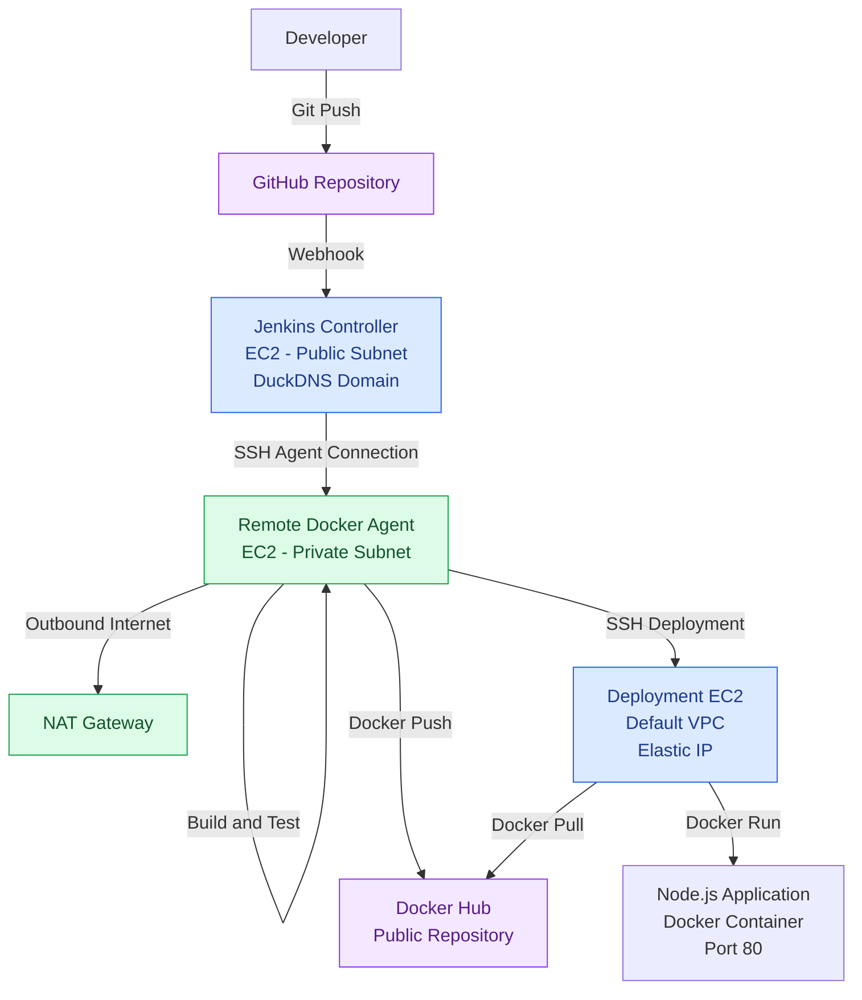
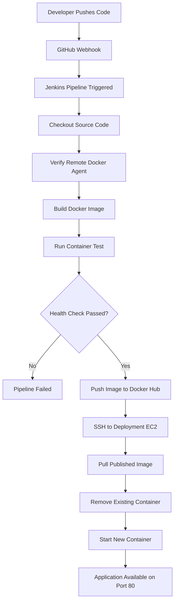

# AWS Remote Jenkins CI/CD Pipeline with Docker

A remote, multi-instance CI/CD infrastructure on AWS using Jenkins, Docker, Docker Hub, GitHub Webhooks, and EC2.

This project demonstrates an end-to-end automated deployment workflow for a Node.js application. Jenkins orchestrates the pipeline, a dedicated remote Docker agent handles container builds and testing, Docker Hub stores versioned images, and a separate EC2 deployment server runs the application.

The infrastructure is distributed across separate AWS network environments to demonstrate remote CI/CD execution, SSH-based communication, network isolation, and containerized application deployment.

---

## 1. Project Overview

The objective of this project is to build a remote CI/CD environment rather than running Jenkins, Docker builds, and application deployments on a single machine.

The implementation follows a distributed architecture with three dedicated EC2 instances:

- **Jenkins Controller:** Manages pipeline execution, GitHub integration, and build orchestration.
- **Docker Agent:** Executes Docker builds, container testing, and Docker Hub image publishing.
- **Deployment Server:** Pulls published Docker images and deploys the Node.js application.

A GitHub push automatically triggers the Jenkins pipeline, which builds, tests, publishes, and deploys the application.

### Key Features

- Remote Jenkins controller and build agent architecture.
- Dedicated Docker build environment in a private subnet.
- GitHub Webhook integration for automated pipeline triggering.
- Docker image versioning using Jenkins build numbers.
- Automated container health testing before publishing.
- Docker Hub integration for image distribution.
- SSH-based deployment to a separate EC2 instance.
- Application deployment using Docker containers.
- AWS networking across separate VPC environments.

---

## 2. Architecture

### Current Architecture

The infrastructure consists of two AWS network environments:

1. A dedicated VPC hosting the Jenkins controller and private Docker agent.
2. The AWS Default VPC hosting the application deployment server.

**AWS Region:** `us-east-1` (N. Virginia)

### Architecture Diagram



### AWS Infrastructure Components

| Component | Infrastructure | Purpose |
|---|---|---|
| Jenkins Controller | EC2 - Public Subnet | Pipeline orchestration |
| Docker Agent | EC2 - Private Subnet | Docker build and testing |
| NAT Gateway | Jenkins VPC | Outbound internet connectivity |
| Deployment Server | EC2 - Default VPC | Application deployment |
| Elastic IP | Deployment EC2 | Stable public endpoint |
| DuckDNS | Jenkins Controller | Domain-based Jenkins access |
| Docker Hub | External registry | Container image storage |

### Network Architecture

**Jenkins VPC**

The Jenkins environment contains two separate subnet configurations.

- Public subnet: Hosts the Jenkins controller.
- Private subnet: Hosts the remote Docker agent.
- NAT Gateway: Provides outbound internet connectivity to the private Docker agent.

The Docker agent does not require a public IP address to communicate with external services because outbound traffic is routed through the NAT Gateway.

**Deployment Environment**

The deployment EC2 instance is hosted separately in the AWS Default VPC.

- Ubuntu-based EC2 instance.
- Docker Engine installed.
- Elastic IP associated with the instance.
- SSH access for remote deployment.
- Application exposed through port 80.

The Docker agent connects to the deployment server using its public Elastic IP over SSH.

This allows deployment without establishing VPC peering or a private network connection between the two VPCs.

---

## 3. CI/CD Workflow

The complete pipeline follows this execution sequence:



### Stage 1: GitHub Webhook

A developer pushes changes to the GitHub repository.

GitHub sends a webhook notification to the Jenkins controller, triggering the configured pipeline.

This removes the need to manually initiate builds.

### Stage 2: Source Code Checkout

Jenkins checks out the application source code from the configured Git repository.

The pipeline uses:

```groovy
checkout scm
```

This retrieves the source code associated with the configured Jenkins SCM pipeline.

### Stage 3: Remote Agent Verification

The pipeline executes on the dedicated Docker agent using:

```groovy
agent {
    label 'docker'
}
```

The agent verifies its execution environment:

- Hostname
- Current Linux user
- Git installation
- Docker installation

All subsequent build and deployment commands execute from this agent.

### Stage 4: Docker Image Build

The Docker agent builds the application image.

Two tags are generated:

- Jenkins build-number tag.
- Latest tag.

Example:

```bash
docker build \
  -t jenkins-aws-docker-lab:BUILD_NUMBER \
  -t jenkins-aws-docker-lab:latest .
```

The build-number tag provides version identification for individual pipeline executions.

### Stage 5: Container Testing

Before publishing the image, Jenkins starts a temporary container on the Docker agent.

The container is mapped to:

```text
127.0.0.1:3000
```

A health-check loop sends HTTP requests to the application.

If the application responds successfully, the stage passes.

If the health check fails, Jenkins captures container logs and marks the pipeline as failed.

A shell trap removes the temporary test container after execution.

This prevents untested images from proceeding to the publishing stage.

### Stage 6: Docker Hub Image Publishing

After successful testing, Jenkins authenticates with Docker Hub using credentials stored in Jenkins Credentials.

The image is tagged with the Docker Hub username:

```text
354arjun/jenkins-aws-docker-lab:BUILD_NUMBER
354arjun/jenkins-aws-docker-lab:latest
```

Both tags are pushed to the public Docker Hub repository.

The build-number tag allows the deployment server to pull a specific pipeline artifact.

### Stage 7: Remote EC2 Deployment

Jenkins uses the SSH Agent plugin and the configured deployment SSH credential.

The Docker agent initiates an SSH connection to the deployment EC2 instance.

The deployment process performs the following operations:

1. Connect to the deployment server.
2. Pull the newly published Docker image.
3. Remove the existing application container.
4. Start a new container.
5. Configure the container to restart automatically.
6. Display the running container status.

The deployment uses:

```bash
docker run -d \
  --name node-cicd \
  --restart unless-stopped \
  -p 80:3000 \
  IMAGE_NAME
```

The application is accessible through the deployment server's Elastic IP or associated domain, if configured.

---

## 4. Jenkins Infrastructure

### Jenkins Controller

The Jenkins controller is hosted on an Ubuntu EC2 instance in the public subnet.

Responsibilities:

- Manage Jenkins jobs and pipelines.
- Receive GitHub webhook notifications.
- Schedule and orchestrate pipeline execution.
- Manage Jenkins credentials.
- Communicate with the remote Docker agent.

A DuckDNS domain is configured to provide domain-based access to Jenkins.

### Remote Docker Agent

A separate Ubuntu EC2 instance runs as the Jenkins build agent.

It is hosted in the private subnet of the Jenkins VPC.

Responsibilities:

- Execute pipeline shell commands.
- Clone application source code.
- Build Docker images.
- Run temporary test containers.
- Authenticate with Docker Hub.
- Push container images.
- Connect to the deployment server over SSH.

The Jenkins controller communicates with the agent using SSH-based agent connectivity.

The agent uses the NAT Gateway for outbound internet communication.

### SSH Authentication

SSH is used for two separate communication paths:

**1. Jenkins Controller → Docker Agent**

Used to establish the remote Jenkins agent connection.

**2. Docker Agent → Deployment EC2**

Used by the deployment stage to execute remote Docker commands.

The deployment SSH private key is managed through Jenkins Credentials and accessed using the SSH Agent plugin.

---

## 5. Deployment Infrastructure

The deployment server is an independent Ubuntu EC2 instance hosted in the AWS Default VPC.

Unlike the Docker agent, this instance is publicly reachable through its Elastic IP.

### Deployment Responsibilities

- Receive deployment commands over SSH.
- Authenticate with Docker Hub when required (the current repository is public, so authentication is not necessary for pulling).
- Pull the requested application image.
- Replace the previous application container.
- Start the latest deployment.
- Keep the container running using Docker restart policies.

### Application Configuration

| Configuration | Value |
|---|---|
| Application | Node.js |
| Container name | `node-cicd` |
| Internal application port | 3000 |
| External application port | 80 |
| Container restart policy | `unless-stopped` |
| Deployment method | Docker CLI over SSH |

### Application Access

```text
http://DEPLOYMENT_ELASTIC_IP/
```

The deployment server exposes port 80 and forwards incoming requests to port 3000 inside the Docker container.

---

## 6. Jenkins Pipeline Implementation

The pipeline is structured into six primary stages:

1. Checkout
2. Verify Agent
3. Build Docker Image
4. Run Container Test
5. Push to Docker Hub
6. Deploy to AWS EC2

### Pipeline Configuration

The pipeline uses:

- Jenkins Declarative Pipeline.
- Docker CLI.
- Git.
- SSH Agent plugin.
- Jenkins Credentials.
- Docker Hub.
- Ubuntu-based remote execution environment.

### Environment Variables

| Variable | Purpose |
|---|---|
| `IMAGE_NAME` | Docker image name |
| `CONTAINER_NAME` | Temporary testing container |
| `DEPLOY_USER` | Deployment SSH username |
| `DEPLOY_HOST` | Deployment EC2 Elastic IP |
| `APP_PORT` | Internal application port |
| `APP_NAME` | Production container name |
| `DOCKERHUB_USERNAME` | Docker Hub account |
| `BUILD_NUMBER` | Jenkins-generated build identifier |

### Credentials

The pipeline references the following Jenkins credentials:

| Credential ID | Type | Purpose |
|---|---|---|
| `dockerhub` | Username with password | Docker Hub authentication |
| `deployement-instance-ssh` | SSH private key | Deployment server authentication |

The Docker Hub password and deployment private key are not directly embedded in the pipeline.

They are retrieved through Jenkins credential management.

---

## 7. Current Security Implementation

Security is an important consideration even in a learning environment.

The current implementation includes the following controls:

- Dedicated Jenkins controller and Docker agent.
- Docker agent hosted in a private subnet.
- NAT Gateway for controlled outbound connectivity.
- SSH-based communication between infrastructure components.
- Jenkins Credentials for sensitive authentication material.
- Separate deployment EC2 environment.
- Elastic IP for stable deployment access.

### Current Security Limitations

Some configurations are intentionally simplified for this initial implementation.

| Area | Current State | Improvement |
|---|---|---|
| Jenkins access | Public subnet | Restrict access through VPN or private access |
| SSH host verification | `StrictHostKeyChecking=no` | Enforce verified SSH host keys |
| Docker Hub repository | Public | Evaluate private registry access |
| Application secrets | Not centrally managed | AWS Secrets Manager |
| Jenkins credentials | Jenkins Credentials Store | Integrate AWS Secrets Manager |
| Deployment access | Public SSH | Restrict source addresses and consider private connectivity |
| Application HTTPS | Not configured | Configure TLS termination |
| Docker communication | SSH agent connectivity | Harden and encrypt relevant Docker daemon connections |
| Deployment strategy | Stop and replace container | Health checks and rollback |
| Monitoring | Jenkins console logs | Centralized monitoring and alerting |

**Important networking consideration:** The deployment SSH connection originates from the Docker agent because the deployment stage runs on the agent. Therefore, the deployment EC2 security group should allow SSH from the NAT Gateway's Elastic IP, rather than assuming the Jenkins controller's public IP is the source.

---

## 8. Future Production Architecture

The current architecture provides a foundation for a more secure and maintainable deployment platform.

The next phase will focus on reducing public exposure, centralized secrets management, secure image distribution, and deployment reliability.

### 8.1 Secure Jenkins Controller Access

The current Jenkins controller is hosted in a public subnet and accessed through DuckDNS.

The planned architecture will remove direct public access to the Jenkins management interface.

Possible improvements:

- Move Jenkins behind a private access layer.
- Use AWS Systems Manager Session Manager or VPN-based access.
- Introduce an application load balancer or reverse proxy where appropriate.
- Configure HTTPS with a trusted TLS certificate.
- Restrict webhook ingress to the necessary endpoint and traffic.

GitHub webhook delivery must remain possible even after Jenkins management access is restricted. This will require a suitable webhook ingress design.

### 8.2 AWS Secrets Manager Integration

Currently, Jenkins Credentials handles Docker Hub authentication and deployment SSH credentials.

The planned implementation will introduce AWS Secrets Manager for centralized secret management.

Potential secrets include:

- Application environment variables.
- Database credentials.
- API keys.
- Third-party service credentials.
- Deployment configuration secrets.

The Jenkins execution environment will use an appropriately scoped IAM role to retrieve authorized secrets.

Secrets should be injected at runtime rather than committed to source control or baked into Docker images.

### 8.3 IAM Role-Based Authentication

The infrastructure will adopt least-privilege IAM permissions.

Potential roles:

- Jenkins controller EC2 role.
- Docker agent EC2 role.
- Deployment EC2 role.

Each role will receive only the permissions necessary for its responsibilities.

For example, if the pipeline later uses Amazon ECR, the relevant execution identity can receive the necessary ECR authentication and image-push permissions.

### 8.4 Secure Docker Communication

The current Jenkins agent uses SSH-based connectivity.

Future improvements will focus on securing Docker daemon communication wherever a remote Docker API is required.

Potential improvements:

- TLS-enabled Docker daemon communication.
- Mutual TLS authentication where applicable.
- Restricted Docker API exposure.
- Dedicated Docker access permissions.
- Secure management of Docker certificates.

The Docker daemon should not be exposed publicly.

### 8.5 Private Registry Integration

Docker Hub is currently used as the image registry.

Amazon Elastic Container Registry (ECR) can be evaluated as a future alternative.

Potential advantages:

- Native AWS IAM integration.
- Private image repositories.
- Reduced dependency on external registry credentials.
- Integration with AWS deployment infrastructure.

### 8.6 Reliable Application Deployment

The current deployment removes the existing container before starting the replacement.

This creates a period of application downtime.

Future improvements will include:

- Container health checks.
- Deployment validation.
- Automatic rollback.
- Graceful shutdown.
- Blue-green deployment or rolling deployment.
- Improved application availability.

### 8.7 Monitoring and Logging

Future monitoring improvements:

- Jenkins build history and execution metrics.
- CloudWatch infrastructure monitoring.
- Application logs.
- Docker container health monitoring.
- Deployment failure notifications.
- Centralized log collection.

---

## 9. Known Limitations

The following limitations apply to the current implementation:

1. Jenkins management access is currently exposed through a public-facing environment.
2. SSH host-key verification is disabled in the deployment command.
3. Docker Hub currently uses a public image repository.
4. Application environment secrets are not yet integrated with AWS Secrets Manager.
5. Deployment replaces the running container rather than performing a zero-downtime rollout.
6. The deployment process does not yet implement automatic rollback.
7. Application HTTPS and production-grade TLS configuration are not yet implemented.
8. The current deployment strategy assumes the application listens on port 3000.
9. The deployment SSH path relies on the Docker agent's outbound NAT connectivity and the deployment server's public endpoint.

These are planned improvements rather than completed production capabilities.

---

## 10. Troubleshooting

### Jenkins agent connection failure

Check:

- SSH connectivity from the controller to the private agent.
- Security group rules.
- SSH username and private key.
- Agent service configuration.
- Network routing.

### Docker permission denied

Check:

```bash
sudo usermod -aG docker jenkins
```

Reconnect the Jenkins agent session after updating group membership.

Verify:

```bash
docker ps
docker --version
```

### Docker Hub authentication failure

Check:

- Jenkins credential ID.
- Docker Hub username.
- Access token validity.
- Credential binding in the pipeline.

### Deployment SSH failure

Check:

- Deployment EC2 public IP / Elastic IP.
- SSH security group rules.
- Deployment username.
- Jenkins SSH credential.
- NAT Gateway outbound connectivity.
- Deployment server SSH service.

### Application unavailable

Check:

```bash
docker ps -a
docker logs node-cicd
docker inspect node-cicd
```

Verify:

- Application listens on port 3000.
- Docker port mapping is correct.
- Security group permits inbound port 80.
- Application starts successfully inside the container.

---

## 11. Project Learnings

This project provided hands-on experience with:

- Distributed Jenkins architecture.
- Jenkins controller and remote agent configuration.
- AWS VPC and subnet design.
- Public and private subnet networking.
- NAT Gateway and outbound connectivity.
- SSH authentication and key-based access.
- Docker image building and container lifecycle management.
- Docker Hub image publishing.
- GitHub Webhook integration.
- Jenkins Declarative Pipelines.
- Remote EC2 deployment automation.
- AWS security groups and network isolation.
- CI/CD security considerations.

---

## 12. Conclusion

This project demonstrates a working remote CI/CD pipeline on AWS using Jenkins and Docker.

Instead of running all workloads on a single EC2 instance, the infrastructure distributes responsibilities across a Jenkins controller, a dedicated private Docker build agent, and a separate application deployment server.

The complete workflow automates source-code checkout, Docker image building, container testing, image publishing, and remote application deployment.

The next phase will focus on evolving this lab into a more production-oriented deployment platform through centralized secrets management, IAM-based access, restricted Jenkins connectivity, secure Docker communication, TLS, monitoring, and reliable deployment strategies.

**Current Status:** End-to-end CI/CD pipeline successfully implemented and tested.

**Future Direction:** Secure, scalable, and production-oriented AWS CI/CD infrastructure.